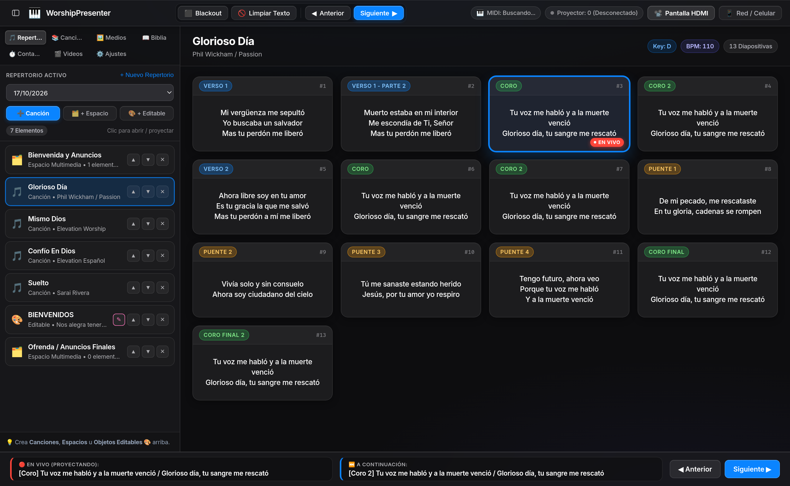
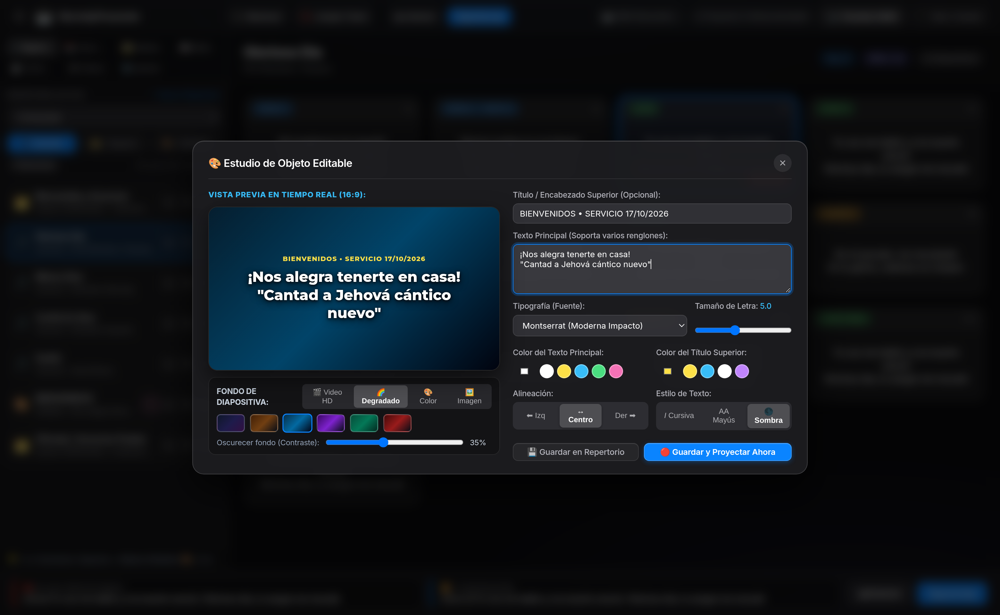
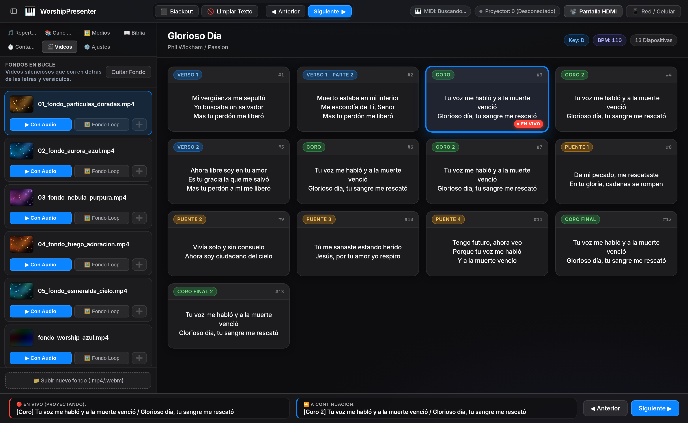

# 🎹 WorshipPresenter — Proyección en Vivo (Apple HIG & Liquid Glass Edition)

Sistema web profesional de proyección de letras, repertorios, objetos editables en vivo, biblias, medios y sincronización inalámbrica **RTP-MIDI (Apple Network MIDI)** en tiempo real.

Rediseñado bajo las **Apple Human Interface Guidelines (macOS Sequoia / Tahoe + Liquid Glass)** para ofrecer una experiencia de estudio limpia, de alto contraste en modo oscuro y con jerarquía visual nativa de macOS.

---

## 📸 Capturas de Pantalla

### 1. Panel de Control Principal — Repertorio y Proyección en Vivo


### 2. Estudio de Objeto Editable en Vivo (WYSIWYG 16:9)


### 3. Fondos de Video HD en Bucle y Biblioteca Multimedia


---

## ✨ Características Principales

### 🍎 Diseño Apple macOS + Liquid Glass (`apple-design-skill`)
- **Arquitectura de Dos Capas**:
  - **Capa Funcional (Liquid Glass)**: Barra superior (`.top-nav`), barra lateral colapsable (`.sidebar`), barra de transporte inferior (`.bottom-bar`), modales y notificaciones utilizan material translúcido **Regular / Thick Liquid Glass** (`backdrop-filter: blur(28px) saturate(1.45)`) con borde especular interno de `0.5px`.
  - **Capa de Contenido (Mac Pro Dark Mode)**: Lienzo principal (`#0D0D0F`) y tarjetas de diapositivas (`#1C1C1E` / `#242426`) en superficies opacas de alto contraste sin apilar vidrio sobre vidrio.
- **Paleta Semántica del Sistema**: Un único color de acento interactivo (`#0A84FF` — `systemBlue` Dark) acompañado de colores semánticos para estados en vivo (`#FF453A`), conexión MIDI/Proyector (`#30D158`), Blackout (`#FF9F0A`) y etiquetas musicales (*Verso*, *Coro*, *Puente*).
- **Tipografía Nativa y Números Tabulares**: Pila tipográfica `-apple-system, BlinkMacSystemFont, "SF Pro Text", "SF Pro Display"` con `font-variant-numeric: tabular-nums` en contadores, relojes, BPM y numeración de diapositivas.
- **Accesibilidad Completa**: Soporte para `@media (prefers-reduced-transparency: reduce)`, `@media (prefers-contrast: more)`, `@media (prefers-reduced-motion: reduce)` y anillos de enfoque `:focus-visible`.

### 🎵 Repertorios del Servicio, Espacios Multimedia y Objetos Editables
- **Gestión de Repertorios por Fecha/Evento**: Crea repertorios personalizados (ej. `17/10/2026`) y organiza todo el orden del culto desde la barra lateral.
- **➕ Canción**: Crea o añade canciones directamente al repertorio activo.
- **📁 + Espacio Multimedia (Drag & Drop)**: Crea contenedores dentro del repertorio donde puedes arrastrar y soltar imágenes o videos desde tu computadora para proyectarlos como diapositivas independientes.
- **🎨 + Objeto Editable en Vivo**: Editor visual 16:9 en tiempo real para crear anuncios, bienvenidas o textos espontáneos cambiando tipografía (*Montserrat*, *Inter*, *Playfair Display*, *Cinzel*, *Oswald*, *Dancing Script*), tamaño, color de texto, alineación, efectos de sombra y fondo (Video HD en bucle, Degradado, Color sólido o Imagen). Si el objeto está proyectándose en vivo, los cambios se reflejan instantáneamente en el proyector.

### 🎹 Sincronización Inalámbrica con Playback / MultiTracks vía Wi-Fi (RTP-MIDI)
- **Servidor Nativo Apple Network MIDI (`rtp-midi.js`)**: Escucha en los puertos UDP `5004` (Control) y `5005` (Datos) y publica automáticamente el servicio Bonjour/mDNS `_apple-midi._udp` en la red local.
- **Integración Directa con Playback (iPad/Mac) y Ableton Live**:
  - Al dar **Play** en Playback, WorshipPresenter detecta los mensajes MIDI (`Note On`, `Control Change`, `Program Change`, `Start/Continue` y `MIDI Clock`) y lanza o avanza automáticamente las secciones de la canción en la ventana de proyección.
  - Incluye modo opcional de **Auto-avance por BPM** sincronizado con el tempo de la canción.

### 🎬 Fondos de Video HD en Bucle (Worship Loops)
- Incluye 5 fondos abstractos en movimiento (`.mp4`) listos para usar detrás de las letras y versículos bíblicos:
  - `loop_1_golden_particles.mp4` — Partículas Doradas
  - `loop_2_blue_nebula.mp4` — Nebulosa Azul
  - `loop_3_warm_sunset.mp4` — Atardecer Cálido
  - `loop_4_purple_aurora.mp4` — Aurora Púrpura
  - `loop_5_emerald_light.mp4` — Luz Esmeralda
- Al seleccionar una canción, si no hay un fondo en movimiento activo, WorshipPresenter asigna automáticamente uno de los fondos HD de alabanza (ignorando clips de texto o intros en la carpeta de medios del programa).

### 📖 Biblia Offline + ⏱️ Reloj Contador + 🌐 Túnel Cloudflare
- **Lectura y Proyección Bíblica 100% Offline**: Incluye **Reina Valera 1960 (RVR1960)** y **Reina Valera Actualizada (RVA)** preinstaladas, con buscador por libro, capítulo y rango de versículos.
- **Reloj Contador Regresivo**: Sincronizado al milisegundo entre todos los operadores y la pantalla HDMI.
- **Túnel Cloudflare Integrado**: Expone el panel de control con HTTPS público (`--tunnel`) para control remoto desde celulares o tablets en cualquier red.

---

## 🚀 Inicio Rápido

### 1. Clonar el Repositorio e Instalar Dependencias
```bash
git clone https://github.com/rafavg77/worship-presenter.git
cd worship-presenter
pnpm install
```

### 2. Iniciar el Servidor
```bash
# Modo Red Local + RTP-MIDI Wi-Fi
pnpm start

# Modo con Túnel Cloudflare Público
pnpm run start:tunnel
```

Al iniciar verás las direcciones activas en consola:
```text
================================================================
   🎹  WORSHIPPRESENTER - SISTEMA DE PROYECCIÓN EN VIVO 2.0      
================================================================
 💻 Panel de Control (Laptop):      http://localhost:3000
 📽️ Pantalla Proyector (HDMI):      http://localhost:3000/display
 📱 Control Remoto (Celular/WiFi):  http://192.168.X.X:3000
 🎹 RTP-MIDI Control escuchando en UDP :5004
 🎹 RTP-MIDI Datos escuchando en UDP   :5005
================================================================
```

---

## ⌨️ Atajos de Teclado

| Tecla | Acción |
|---|---|
| <kbd>Espacio</kbd> o <kbd>→</kbd> | Avanzar a la siguiente diapositiva |
| <kbd>←</kbd> o <kbd>Backspace</kbd> | Retroceder a la diapositiva anterior |
| <kbd>B</kbd> | Alternar **Blackout** (Pantalla Negra) |
| <kbd>C</kbd> | Alternar **Limpiar Texto** (Mantiene el fondo en movimiento) |
| <kbd>F11</kbd> | Pantalla completa en la ventana del proyector HDMI |

---

## 📂 Estructura del Proyecto

```text
worship-presenter/
├── bibles/          # Biblias offline en JSON (rvr1960.json, rva.json)
├── docs/screenshots/# Capturas de pantalla de la interfaz Apple HIG
├── media/           # Fotos, flyers, videos de programa y archivos de espacios
├── playlists/       # Repertorios guardados en JSON (ej. 17/10/2026)
├── songs/           # Catálogo de canciones estructuradas (.txt)
├── videos/          # Fondos HD en bucle para alabanza (.mp4)
├── public/
│   ├── css/         # Sistema de diseño Apple HIG + Liquid Glass (control.css, display.css)
│   ├── js/          # Lógica de cliente y sincronización Socket.IO (control.js, display.js)
│   ├── index.html   # Panel de Control para operador
│   └── display.html # Ventana de proyección limpia para salida HDMI
├── rtp-midi.js      # Servidor nativo Apple Network MIDI (UDP 5004/5005 + mDNS)
├── server.js        # Servidor Express + Socket.IO + API REST + Cloudflare Tunnel
└── package.json
```
